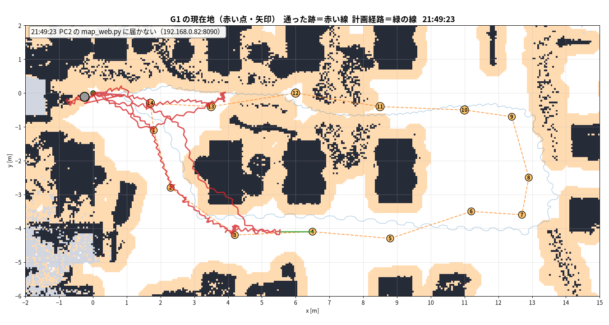

# live_map — 走っている G1 の位置を、地図の画像に自動で描き続ける

Nav2 で G1 を自律移動（見回り・Goal）させている間、**G1 が地図のどこにいて、どこを通り、どこで止まったか**を、
人が見やすい地図の画像（PNG）に 1 秒ごとに描き直す道具です。VSCode などでその PNG を開いておくと、表示が自動で更新されます。

2026-10-17 に、無線（WiFi）で G1 を見回りさせたときに作り、実機で使いました（下の「見本」）。

- **見るだけ。** ロボットには何も送りません
- **操作 PC に ROS は要りません。** Python と numpy・opencv・scipy・matplotlib だけで動きます
- 無線では DDS を通しません。PC2 の中で ROS を購読する [../map_web.py](../map_web.py) が HTTP で配る位置を受け取ります
  （[../../WIRELESS.md](../../WIRELESS.md) の方針と同じ）

## 見本（2026-10-17 に実機で使った画像）



| 見えているもの | 意味 |
|---|---|
| 白 | 通れる場所 |
| 薄いオレンジ | **狭い所**（障害物まで 0.35 m 未満。G1 の体の半径 約 0.32 m では通りにくい） |
| 濃い紺 | 障害物（机・椅子・壁など） |
| 灰 | 未知（LiDAR から見えていなかった所。Nav2 は通れない扱いにする） |
| 薄い青の線 | 地図を作ったときに歩いた経路 |
| 緑の点 (0, 0) | 地図の原点（地図を作り始めた位置）。**+x はそのときの G1 の正面、+y は左** |
| 橙の丸の番号と点線 | 見回りの目的地と順番（この見本は逆回り） |
| **赤い点と矢印** | **G1 の現在位置と向き**。灰色なら、位置が 2 秒以上更新されていない |
| **赤い線** | **通った跡**（5 cm 動くごとに記録） |
| 緑の線 | Nav2 が計画した経路 |
| 左上の枠 | 時刻・状態（READY / NAVIGATING / FAULT と理由）・位置・位置が何秒前の値か |

この見本から分かったこと: 赤い線が細かく折れ曲がっている所が 2 か所あります。Nav2 が前に進めず、立て直しを繰り返した場所です。
1 つは机の島の北側の狭い区間、もう 1 つは目的地 4 の 0.9 m 手前（カメラで見ると、机の天板が通路に張り出していました）。
この見本の点が灰色なのは、G1（PC2）を再起動して位置が届かなくなったあとの 1 枚だからです（最後に分かっていた位置を残します）。

## 中身

| ファイル | やること |
|---|---|
| `live_map.py` | **本体。** PC2 の map_web.py から位置を受け取り、地図の PNG を 1 秒ごとに描き直す |
| `render_map.py` | 地図を、凡例・目盛り・物差し付きの見やすい PNG にする（静止画。目的地や現在位置も描ける）。live_map.py の背景もこれで描く |
| `pick_waypoints.py` | 地図を作ったときの軌跡に沿って、障害物から離れた見回りの目的地を選ぶ |
| `maplib.py` | 共通の部品（地図の読み込み、色分け、日本語フォント） |
| `examples/` | 見本の画像 |

## 全体の流れ

```
 PC2（G1 の中）                                   操作 PC（あなたの PC）
 ┌──────────────────────────────┐   WiFi(HTTP)   ┌────────────────────────────┐
 │ Nav2 ─ TF(map→base_link)     │                │ live_map.py                │
 │          ↓ 購読               │  state.json    │   1 秒ごとに受け取り、       │
 │ map_web.py :8090 ────────────┼──────────────→ │   地図の PNG を描き直す ──→ VSCode で開く
 └──────────────────────────────┘                └────────────────────────────┘
```

## 用意するもの

| もの | 例（2026-10-17） |
|---|---|
| Nav2 に渡すのと同じ地図（map_server 形式の `.yaml` と `.pgm`） | `navmap_20261017.yaml` |
| 地図を作ったときの軌跡（TUM 形式。任意だが、あると見やすく、見回りの目的地も選べる） | `trajectory.tum`（[../bag_odom_to_tum.py](../bag_odom_to_tum.py) で `/unitree/slam_mapping/odom` から作る） |
| 操作 PC の Python | numpy・opencv-python・scipy・matplotlib が入ったもの |
| 日本語のフォント（文字化けを防ぐ） | `fonts-noto-cjk`（Ubuntu なら `sudo apt install fonts-noto-cjk`） |
| PC2 に map_web.py が配置されていること | 無ければ有線で `rsync -a tools/ g1:/home/unitree/g1_nav2/tools/` |

以下、`L=Navigation/nav2_stable/tools/live_map`、`PY=<上の Python>`、PC2 の無線の IP は `192.168.0.82` とします。

## 手順

### 0. （任意）見やすい地図と、見回りの目的地を作る

```bash
# 地図を見やすい画像にする（凡例・目盛り・物差し付き）
$PY $L/render_map.py --map navmap.yaml --trajectory trajectory.tum --out map_readable.png

# 地図を作ったときの軌跡に沿って、見回りの目的地を選ぶ（逆回りなら --reverse）
$PY $L/pick_waypoints.py --map navmap.yaml --trajectory trajectory.tum --out patrol.txt

# 見回りルートの画像
$PY $L/render_map.py --map navmap.yaml --trajectory trajectory.tum --points-file patrol.txt --loop \
  --crop 1.5 --title "見回りルート" --out patrol_route.png
```

- `pick_waypoints.py` は、最後に目的地の並び（`x1 y1 x2 y2 ...`）を出します。目的地を送るときにそのまま使えます
- **目的地を自分で決めたときも、送る前に `render_map.py --points ...` で確かめてください。** 通れない場所や、
  障害物に近すぎる所（`⚠ 狭い`）には警告が出ます。10/17 に障害物まで 0.05 m の点を送ったら、近づけずに止まりました

### 1. Nav2 を起動する

いつもどおり（[../../WIRELESS.md](../../WIRELESS.md)、[../../safety/runbook_nav2_session.md](../../safety/runbook_nav2_session.md)）。
live_map はロボットを動かす操作とは独立しているので、走らせる前でも後でも始められます。

### 2. PC2 で map_web.py を起動する（読むだけ）

```bash
cd Navigation/nav2_stable
export G1_WIFI_IP=192.168.0.82
tools/wifi_ops.sh mapview start
```

届くか確かめる（`pose` と `trail` が入っていれば OK）:

```bash
curl -s http://192.168.0.82:8090/state.json | head -c 300
```

### 3. 操作 PC で live_map.py を動かし続ける

```bash
$PY $L/live_map.py --map navmap.yaml --trajectory trajectory.tum --points-file patrol.txt --loop \
  --host 192.168.0.82 --save-state latest_state.json --out live_position.png
```

ターミナルを閉じても止めたくないときは、裏で動かします:

```bash
setsid nohup $PY $L/live_map.py ...（上と同じ引数）... > live_map.log 2>&1 < /dev/null &
```

### 4. 画像を開く

```bash
code -r live_position.png     # VSCode。狭ければタブをダブルクリックして広げる。別ウインドウなら code -n
```

1 秒ごとに書き換わり、表示も自動で変わります（10/17 に画面を撮って確認）。

### 5. 止める

```bash
kill <live_map.py の PID>                 # 操作 PC
tools/wifi_ops.sh mapview stop            # PC2 の map_web.py
```

### 6. あとで振り返る

`--save-state latest_state.json` を付けておくと、受け取った最新の状態（位置・通った跡・計画経路・状態）が毎回保存されます。
止まったあとに、そのときの画像を描き直せます:

```bash
$PY $L/live_map.py --map navmap.yaml --trajectory trajectory.tum --points-file patrol.txt --loop \
  --state-file latest_state.json --once --out at_stop.png
```

## live_map.py のオプション

| オプション | 既定 | 意味 |
|---|---|---|
| `--map` | （必須） | 地図の `.yaml`（Nav2 に渡したものと同じ） |
| `--trajectory` | なし | 地図を作ったときの軌跡（TUM 形式） |
| `--points` / `--points-file` | なし | 目的地（`x1 y1 x2 y2 ...` か、1 行に `x y` のファイル） |
| `--loop` | オフ | 最後の目的地から最初へ線を戻す（見回りの 1 周） |
| `--reverse` | オフ | 目的地の番号を逆回りの順に付ける（送る順と番号をそろえる） |
| `--host` / `--port` | 192.168.0.82 / 8090 | map_web.py の場所 |
| `--interval` | 1.0 | 描き直す間隔 [秒] |
| `--stale` | 2.0 | 位置がこの秒数以上古いと、点を灰色にして警告する |
| `--crop` | 1.5 | 軌跡と目的地を囲む範囲 + この余白 [m] に切り詰める。負の値で地図全体 |
| `--xlim` / `--ylim` | なし | 表示範囲を直接決める |
| `--narrow` | 0.35 | 障害物までこの距離 [m] 未満を「狭い所」の色にする |
| `--save-state` | なし | 受け取った最新の state.json を保存する |
| `--state-file` + `--once` | なし | 保存した state.json から 1 枚だけ描く（振り返り・動作確認） |
| `--out` | （必須） | 出力する PNG |

## 困ったとき（10/17 に実際に踏んだもの）

| 症状 | 原因と対処 |
|---|---|
| 左上に「PC2 の map_web.py に届かない」と出て、点が灰色 | map_web.py が動いていないか、無線が切れている。PC2 を再起動すると map_web.py も消えるので、手順 2 からやり直す。live_map.py は止めなくてよい（届けば自動で戻る） |
| 赤い線（通った跡）が前の走行のまま残っている | map_web.py は Nav2 を起動し直しても跡を残す。消したいときは `tools/wifi_ops.sh mapview stop` → `start` |
| 位置が明らかにずれている | 表示しているのは機体が**推定した**位置。自己位置がずれていても、表示は正常に見える。目視と併用する |
| 赤い線が細かく折れ曲がって、先に進まない | Nav2 が前に進めず、立て直しを繰り返している。目的地が狭い所に無いか（`render_map.py --points` で確認）、地図に無い障害物（机の天板の張り出し、人など）が無いかを疑う |
| 文字が □ に化ける | 日本語のフォントが無い。`sudo apt install fonts-noto-cjk` |
| VSCode の表示が小さい | タブをダブルクリックして編集エリアを広げる。または `code -n live_position.png` で別ウインドウに開く |
| PC2 のログの時刻が 1 時間ずれている | PC2 の時計は UTC+8（日本時間より 1 時間遅い） |

## 動作を確かめた環境（2026-10-17）

- 操作 PC: Ubuntu、Python 3.12（numpy 2.2、opencv 5.0、scipy、matplotlib）、VSCode（snap）
- 無線: `Physical_AI_5G`、PC2 は 192.168.0.82
- 実機で見回り（順回り・逆回り）の間に動かし、1 秒ごとに更新されることを確認
- 保存した state.json から、止まったときの画像（見本）を描き直せることを確認
